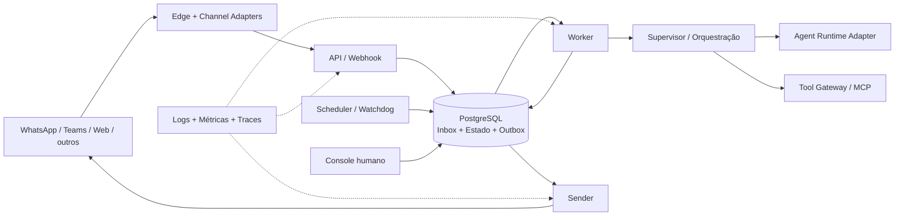

# Chat Design Reference

[](https://github.com/caleo-hub/chat-design-reference/actions/workflows/ci.yml)
[](LICENSE)
[](pyproject.toml)

Arquitetura de referência e template para construir chats profissionais com IA em **Python**, executados em **VPS**, seguindo o estilo de **monólito modular**.

O objetivo é evitar que cada novo chatbot precise redescobrir infraestrutura, confiabilidade, segurança, memória, filas, observabilidade, handoff humano e integração com ferramentas. Um projeto derivado deve trocar apenas as variabilidades do seu caso — canais, identidade, framework de agentes, modelos, prompts, MCPs, conhecimento e políticas — sem desmontar os invariantes operacionais.

> Estado atual: **fundação arquitetural v0.1**. Este repositório contém especificações, contratos, decisões, módulos de referência e um harness mínimo. Ainda não é um produto pronto para produção.

## Problema que o template resolve

Um chat de IA profissional é mais do que um endpoint que chama um LLM. Ele precisa receber mensagens de múltiplos canais, preservar ordem e idempotência, executar agentes e ferramentas com segurança, informar progresso, sobreviver a falhas, entregar respostas de forma confiável, permitir intervenção humana e produzir evidências operacionais.

Este repositório torna essas preocupações explícitas e reutilizáveis.

## Decisão arquitetural principal

O sistema é um **monólito modular**: um único código-fonte e um único artefato de aplicação, com módulos internos e contratos rigorosos. Na VPS, o mesmo artefato pode assumir papéis de processo distintos — API, worker, sender e scheduler — para isolamento de falhas e escala operacional sem transformar o produto em microsserviços.



## O que é invariável

Projetos derivados devem preservar, salvo ADR explícito:

- webhook rápido: autenticar, normalizar e persistir; nunca executar LLM no request;
- envelope canônico independente do canal;
- processamento assíncrono, durável e idempotente;
- ordenação por conversa e lease renovável;
- efeitos externos gravados antes na transactional outbox;
- separação entre estado operacional, conversacional e telemetria;
- ações sensíveis protegidas por regras determinísticas e aprovação quando necessária;
- tools externas atrás de uma porta própria, preferencialmente MCP;
- retries apenas com semântica de idempotência e resultado conhecido;
- DLQ, reconciliação, heartbeat, watchdog, nudge, timeout e cancelamento;
- correlação ponta a ponta, logs sanitizados e rastreabilidade de versões;
- núcleo de aplicação sem dependência de FastAPI, LangChain, CrewAI ou SDK de canal.

## O que é configurável

- canais: WhatsApp, Teams, Slack, Telegram, web, API própria;
- autenticação e resolução de identidade;
- framework: LangGraph/LangChain, CrewAI, SDK próprio ou outro adapter;
- provedor/modelo de LLM;
- prompts, políticas e especificações dos agentes;
- MCPs, tools internas e permissões;
- memória, RAG e fontes de conhecimento;
- regras de handoff, aprovação e atendimento humano;
- limites, SLOs, retenção, multitenancy e políticas de dados;
- componentes opcionais de observabilidade.

Veja [Customização](docs/architecture/customization.md).

## Perfis de maturidade

| Perfil | Finalidade | Características |
|---|---|---|
| POC | validar hipótese | um canal, um fluxo, persistência mínima e sem efeitos críticos |
| MVP | uso real controlado | fila durável, worker, outbox, MCP, memória, handoff, métricas, backup e rollback |
| Profissional | operação contínua e expansão | múltiplos canais/tenants, evals, console, circuit breakers, progressive delivery e testes de recuperação |

A matriz completa está em [Níveis de maturidade](docs/architecture/maturity-levels.md).

## Módulos de referência

- `channels`: normalização e capacidades dos canais;
- `identity`: ator, conta, tenant e autorização;
- `conversations`: sessões, turns, mensagens e ordenação;
- `orchestration`: supervisor, políticas e máquinas de estado;
- `agent_runtime`: porta neutra e adapters de frameworks;
- `tools`: catálogo, autorização, MCP e execução segura;
- `memory`: memória de sessão e memória durável curada;
- `knowledge`: recuperação e evidências de conhecimento;
- `jobs`: inbox, leases, retries, DLQ, heartbeat e watchdog;
- `delivery`: outbox, sender e status do canal;
- `handoff`: revisão, aprovação e atendimento humano;
- `observability`: correlação, métricas, traces, evals e auditoria;
- `operations`: health, admin, backup, restauração e rollout;
- `governance`: versões de prompt/modelo/grafo e políticas.

Detalhes e dependências permitidas: [Catálogo de módulos](docs/architecture/modules.md).

## Estrutura do repositório

```text
.
├── .github/               CI, ownership, PR template e Dependabot
├── specs/                 princípios e comportamento verificável
├── docs/
│   ├── adoption/          aplicação do runbook a priori
│   ├── product/           visão e PRD da referência
│   ├── architecture/      C4, runtime, módulos e deploy
│   ├── adr/               decisões arquiteturais
│   ├── security/          threat model
│   └── runbooks/          criação e operação
├── contracts/             OpenAPI e JSON Schemas
├── config/                perfil de customização
├── src/                   harness e contratos Python
├── tests/                 contratos, arquitetura e smoke tests
├── CHANGELOG.md           evolução da referência
└── LICENSE                Apache License 2.0
```

## Começar um novo chat

1. Use este repositório como template, faça fork ou clone para um novo projeto.
2. Copie `config/reference.example.yaml` para um perfil do produto.
3. Preencha visão, riscos, política de dados e SLOs.
4. Escolha adapters de canal, agent runtime e MCP.
5. Especifique agentes e tools antes de implementá-los.
6. Implemente uma fatia vertical, preservando os fitness functions.
7. Suba em ambiente local/VPS e execute os testes de falha e restauração.

Runbook completo: [Criar um novo chat](docs/runbooks/create-new-chat.md).

## Comandos canônicos

```bash
make bootstrap
make check
make verify
make run
```

## Governança da referência

- mudanças estruturais exigem ADR;
- contratos públicos exigem versionamento e compatibilidade explícita;
- alterações críticas usam revisão proporcional ao risco;
- `CODEOWNERS` protege as fontes arquiteturais;
- o template de PR exige evidências, risco e rollback;
- Dependabot acompanha dependências Python e GitHub Actions;
- o changelog registra releases da referência.

## Fontes de verdade

- princípios: `specs/constitution.md`;
- arquitetura: `docs/architecture/index.md`;
- contratos públicos: `contracts/`;
- decisões: `docs/adr/`;
- segurança: `docs/security/threat-model.md`;
- operação: `docs/runbooks/`;
- estado da adoção: `docs/adoption/STATUS.md`.

## Licença e uso

Este projeto é distribuído sob a [Apache License 2.0](LICENSE). A licença permite reutilização e adaptação da referência, observadas suas condições de atribuição, avisos e redistribuição.
