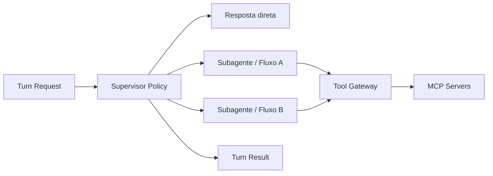

# Agentes, Supervisor, subagentes e tools

## Padrão de orquestração

A referência usa Supervisor/Subagentes como padrão conceitual, mas não obriga um framework.



## AgentRuntime port

O núcleo envia uma requisição estruturada:

- mensagens/contexto permitido;
- identidade e tenant;
- estado do fluxo;
- catálogo de tools filtrado;
- budgets de tempo, tokens e custo;
- versões de prompt/modelo/grafo;
- correlation/trace context.

E recebe:

- resposta canônica;
- sinais estruturados;
- handoff/approval request;
- tool intents/resultados;
- usage e diagnóstico sanitizado.

Adapters possíveis:

- LangGraph/LangChain;
- CrewAI;
- SDK/provider native;
- máquina de estados própria;
- runtime de teste determinístico.

## Supervisor

Responsabilidades:

- escolher resposta direta ou subfluxo permitido;
- preservar continuidade de fluxo ativo;
- aplicar policy antes e depois do runtime;
- limitar loops, tools, tokens e tempo;
- produzir resultado estruturado.

Não deve:

- executar integração externa diretamente;
- inventar pós-condição;
- substituir autorização;
- decidir replay de mutação desconhecida.

## Subagentes e fluxos

Cada subfluxo implementa contrato comum:

```text
input: TurnContext + FlowState + UserMessage
output: FlowResult
  - response
  - state_patch
  - final
  - signals
  - handoff
  - requested_effects
```

Fluxos transacionais preferem state machine explícita. O LLM pode extrair/classificar/formular, enquanto código decide transições e efeitos.

## Tool Gateway

Camada única entre orquestração e tools:

- discovery e allowlist por escopo;
- autenticação e propagação de contexto seguro;
- validação de input/output;
- timeout, cancelamento e limites;
- classificação read-only/mutating/destructive;
- idempotency key;
- auditoria e métricas;
- circuit breaker e bulkhead;
- transformação de erro em resultado canônico.

## MCP

MCP é preferido para integrações externas ou reutilizáveis. O server MCP possui as regras da integração; o chat possui as regras da conversa e autorização do produto.

Regras:

- HTTP autenticado; stdio recebe secrets do ambiente;
- token de usuário não é repassado sem contrato apropriado;
- tools recebem menor contexto necessário;
- tool result usa schema versionado;
- resources não são promovidos automaticamente a verdade;
- mutações críticas podem ser chamadas somente por nó determinístico;
- tasks MCP experimentais podem representar call-now/fetch-later, mas o job operacional do chat continua fonte de verdade.

## Taxonomia de resultado

- `succeeded`;
- `not_found`;
- `needs_user_input`;
- `needs_human`;
- `rejected`;
- `retryable_error`;
- `permanent_error`;
- `outcome_unknown`.

O LLM não recebe exceção crua nem interpreta HTTP status como sucesso.

## Versionamento

Cada turn registra:

- `agent_runtime` e versão;
- provider/modelo e parâmetros relevantes;
- prompt version;
- graph/crew version;
- tool catalog/schema version;
- feature flags;
- deployment SHA.
