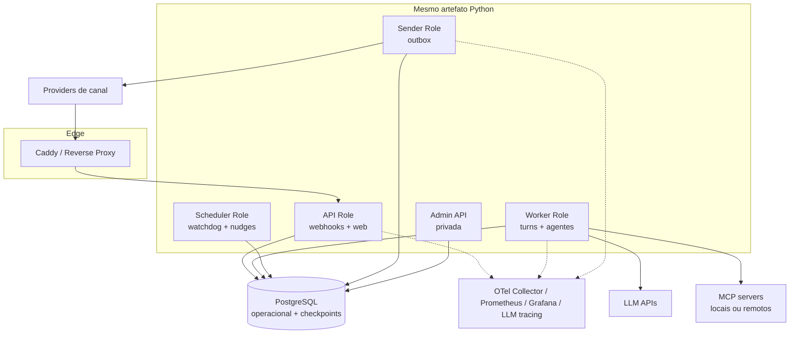

# C4 — Containers e papéis de runtime

## Monólito modular não significa processo único

A referência possui um único código-fonte, modelo de domínio e artefato de aplicação. Para confiabilidade, o mesmo artefato pode rodar em papéis separados na VPS.

## Papéis

### API

- autenticar webhook;
- limitar payload e taxa;
- normalizar envelope;
- deduplicar e persistir na inbox;
- retornar rapidamente;
- oferecer SSE/WebSocket para canal web quando configurado;
- não executar LLM, tool ou envio de negócio.

### Worker

- claim com lease e ordenação;
- preprocessar mídia;
- resolver identidade e sessão;
- executar supervisor/subagentes;
- chamar tools por gateway;
- persistir estado e resposta/outbox;
- renovar lease e respeitar cancelamento.

### Sender

- claim de outbox;
- adaptar mensagem à capacidade do canal;
- enviar, registrar ID do provider e status;
- retry seguro e DLQ;
- nunca inferir `delivered` a partir de `accepted`.

### Scheduler/Watchdog

- heartbeats e leases expirados;
- nudges e timeouts;
- limpeza de janelas e retenção;
- reconciliações periódicas;
- jobs de sync/RAG;
- alertas de stale cache e backlog.

### Admin/Console

- fila, DLQ e eventos;
- handoffs e aprovações;
- reprocessamento com motivo;
- versões de prompt/modelo/grafo;
- operação protegida e auditada.

## Stores

O MVP usa PostgreSQL para estado operacional, checkpoints e dados do produto. Schemas ou bancos separados devem distinguir:

- `app`: inbox, jobs, conversas, outbox, handoff e auditoria;
- `agent_state`: checkpoints/store do runtime;
- `observability`: preferencialmente backend próprio;
- `tool_cache`: quando uma integração exige cache e idempotência próprios.

## Componentes opcionais

- Redis não é obrigatório no MVP; pode entrar por evidência de gargalo específico;
- object storage local/S3-compatible para mídia, com retenção explícita;
- vector store só quando existir caso de conhecimento;
- broker dedicado apenas quando PostgreSQL não sustentar os atributos medidos.
