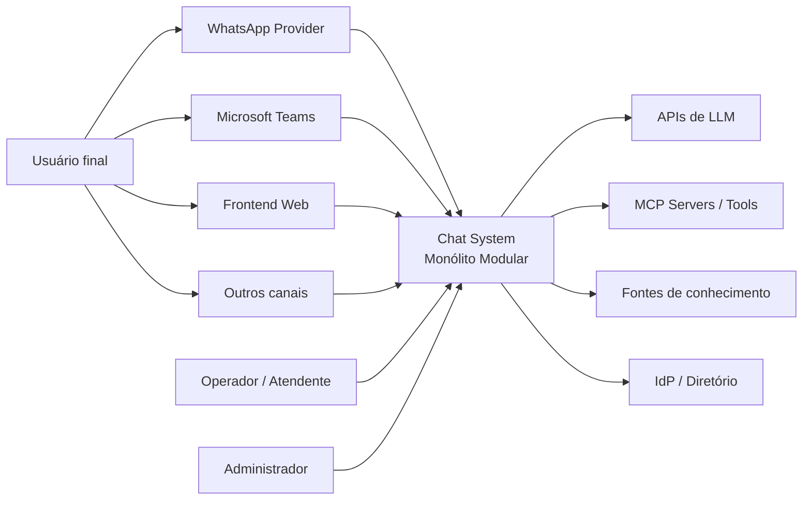

# C4 — Contexto

## Sistema de interesse

O Chat System recebe interações de múltiplos canais, coordena agentes e ferramentas, mantém estado, entrega respostas e oferece operação humana e observabilidade.

## Atores

| Ator | Objetivo | Confiança inicial |
|---|---|---|
| Usuário final | conversar e solicitar ações | não confiável até autenticação/resolução |
| Operador humano | revisar, aprovar, responder e reconciliar | autenticado e autorizado por função |
| Administrador | configurar canais, agentes, tools e operação | privilegiado, auditado |
| Agente de código | evoluir o template/projeto | menor privilégio, sem produção por padrão |

## Sistemas externos

- providers de canal entregam webhooks e recebem mensagens;
- APIs de LLM fornecem inferência, embeddings, visão ou áudio;
- MCP servers expõem tools e resources;
- fontes de conhecimento fornecem conteúdo recuperável;
- IdP/diretório valida identidades quando aplicável;
- observabilidade pode ser self-hosted ou externa, mas é best effort.

## Fronteiras de confiança

1. Internet → edge/webhook.
2. Canal → identidade interna.
3. LLM → decisão de negócio.
4. Chat → MCP/tool externa.
5. Aplicação → dados de outro tenant.
6. Operador → ações administrativas.
7. Telemetria → armazenamento e visualização.

Cada fronteira exige contrato, autenticação, autorização, limite, auditoria e comportamento de falha explícito.
