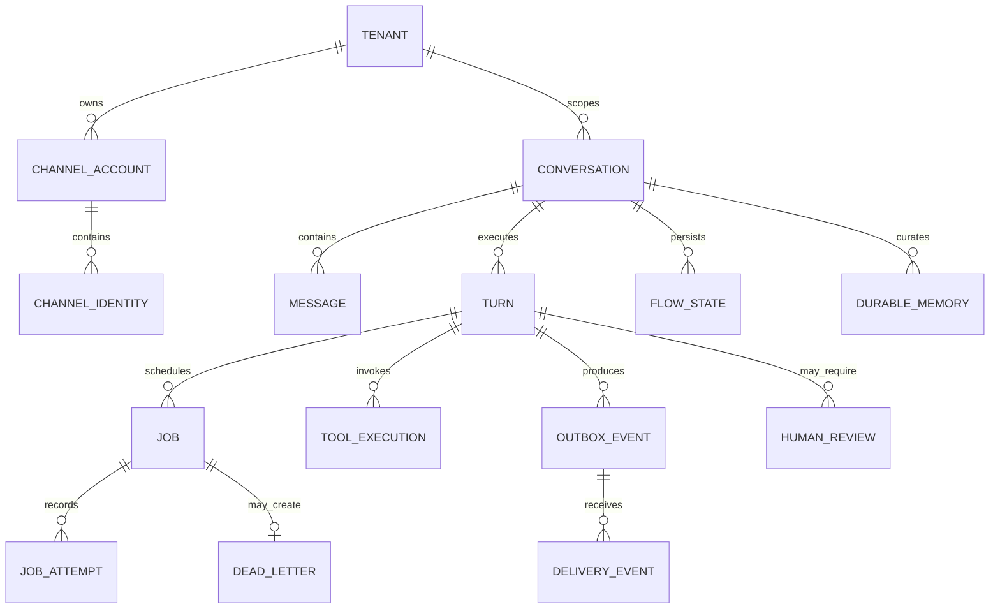

# Dados e estado

## Três classes de estado

### Operacional

Fonte de verdade para execução:

- inbound receipt e inbox;
- jobs, attempts, lease e deadline;
- outbox e delivery events;
- DLQ e reconciliação;
- heartbeat, nudge e scheduler;
- handoff/approval;
- auditoria operacional.

### Conversacional

- conversation e session;
- mensagens canônicas;
- turn state;
- estado de fluxo/subagente;
- checkpoints do runtime;
- memória de sessão e memória durável aprovada.

### Observabilidade

- traces/spans;
- tokens/custo;
- métricas e logs;
- eval scores;
- diagnóstico sanitizado.

Observabilidade nunca é requisito para concluir um turn.

## Modelo conceitual

## Chaves e escopos

Toda chave inclui tenant quando multitenancy estiver habilitada.

- receipt: `(tenant, channel, channel_account, provider_event_id)`;
- conversation: `(tenant, channel, external_conversation_id)` ou vínculo canônico;
- turn: UUID interno + correlation ID;
- tool mutation: `(tenant, tool, idempotency_key)`;
- delivery: `(channel, recipient, delivery_key)`;
- nudge: `(turn_id, nudge_stage)`.

## Consistência

- receipt e inbox na mesma transação;
- resposta, estado do turn e outbox na mesma transação;
- mudança de estado e audit event preferencialmente na mesma transação;
- efeito externo não participa da transação local: usa idempotência, saga/reconciliação;
- checkpoint de framework não substitui o estado operacional.

## Retenção

Cada projeto define:

- payload bruto de webhook;
- texto de mensagem;
- mídia;
- memória durável;
- traces e prompts;
- audit events;
- DLQ e reconciliação;
- backups.

Exclusão precisa considerar referências, backups e requisitos legais. Não existe default universal seguro.

## Migrations

- nunca editar migration já aplicada;
- mudanças aditivas antes de consumidores novos;
- backfill separado e resumível;
- rollout compatível com versão anterior;
- migration destrutiva exige backup/restauração testados;
- índices de fila criados sem bloquear quando necessário.
