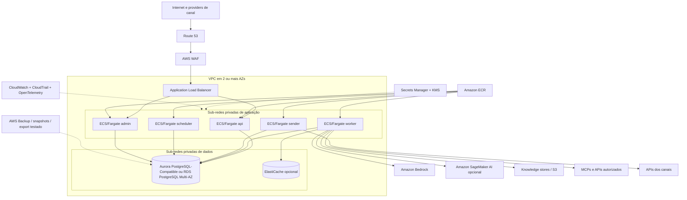

# Deploy de referência na AWS

## Objetivo

Executar o mesmo monólito modular em serviços gerenciados da AWS, mantendo o núcleo independente da nuvem e preservando inbox, leases, transactional outbox, `AgentRuntime`, `ToolGateway`, handoff e auditabilidade.

Este perfil complementa o [deploy em VPS](deployment-vps.md). Não substitui decisões de domínio nem torna serviços AWS obrigatórios.

## Topologia recomendada para MVP/produção inicial

## Papéis de runtime

Todos os papéis usam a mesma imagem fixada por digest e recebem um comando/role diferente.

### API

- atrás do ALB; somente endpoints públicos necessários;
- verifica assinatura, timestamp e replay do canal;
- normaliza `ChannelEnvelope`;
- grava receipt/inbox na mesma transação;
- retorna sem invocar LLM, RAG, mídia pesada ou tool;
- readiness depende da capacidade de persistir entrada.

### Worker

- sem endpoint público;
- claim com lease e ordering por conversa;
- acessa Bedrock/SageMaker AI por adapter;
- chama knowledge e Tool Gateway sob policy;
- grava estado e outbox atomicamente;
- renova lease e respeita cancelamento/budget;
- escalabilidade usa idade da fila, backlog e throughput, não somente CPU.

### Sender

- sem endpoint público;
- claim da outbox, renderização por capability e envio;
- registra provider ID e status sem confundir accepted com delivered;
- retry idempotente e DLQ/reconciliação;
- egress apenas para providers de canal autorizados.

### Scheduler/Watchdog

- executa leases expirados, nudges, deadlines, retenção, sync e reconciliação;
- pode ser service persistente, ECS scheduled task ou EventBridge Scheduler invocando o mesmo artefato;
- cada ação é idempotente e auditada.

### Admin/Console

- acesso privado por VPN, identity-aware proxy, bastion controlado ou rede corporativa;
- RBAC/MFA, audit event e segregação de funções;
- replay, approval, export e config exigem motivo e policy.

## Contas e ambientes

Baseline recomendado:

- conta de **shared/security/log archive** quando a organização já usa landing zone;
- contas separadas de **dev**, **staging** e **prod**;
- opcionalmente uma conta/célula por domínio ou tenant de alto risco;
- identidades humanas via IAM Identity Center; workloads via task roles;
- sem chaves IAM long-lived no container.

Projetos menores podem iniciar em menos contas, desde que produção, logs/auditoria e privilégios sejam separados de forma explícita e exista plano de evolução.

## Rede

- VPC em pelo menos duas AZs para perfil produtivo;
- ALB nas sub-redes públicas; tasks e banco em sub-redes privadas;
- PostgreSQL sem acesso público;
- security groups referenciando security groups, não ranges amplos;
- endpoints privados/VPC endpoints quando suportados e economicamente apropriados;
- egress por NAT/proxy controlado ou firewall conforme risco;
- DNS, NTP, certificados e rotação monitorados;
- admin e métricas não expostos à internet.

Avalie custo e disponibilidade de NAT por AZ. Um único NAT pode reduzir custo e criar blast radius; a decisão deve refletir o SLO.

## Persistência

### PostgreSQL

O banco continua fonte de verdade para:

- receipt/inbox;
- jobs, attempts, lease, heartbeat e deadlines;
- conversations, turns e flow state;
- outbox/delivery events;
- DLQ e reconciliação;
- handoff/approval e audit events.

Configurar:

- Multi-AZ conforme SLO;
- backups automáticos e retenção aprovada;
- encryption com KMS;
- parameter/connection limits;
- pool por papel;
- índices da fila e autovacuum observados;
- migrations explícitas, aditivas e compatíveis;
- restore periódico em conta/ambiente limpo.

Aurora ou RDS são opções. A escolha depende de carga, operação, custo, extensões, RPO/RTO e experiência; não existe default universal.

### S3

Usar para mídia, corpus, datasets, manifestos, artefatos e backups/exportações quando aplicável:

- buckets por ambiente/finalidade;
- block public access;
- encryption e bucket policies;
- versioning quando recuperação exigir;
- lifecycle e retenção;
- object tags/classificação;
- malware scanning e validação de mídia;
- URLs assinadas curtas e nunca registradas integralmente.

### Cache e vector stores

- ElastiCache é cache, não fonte do job/outbox;
- vector store deve poder ser reconstruído de corpus + manifesto;
- modelo/dimensão/chunking fazem parte da versão do índice;
- backup, replication e freshness seguem o RPO/RTO do knowledge, não o do banco automaticamente.

## Modelos, RAG e tools

### Amazon Bedrock

Pode implementar modelos gerenciados, guardrails, knowledge bases ou agents. Use adapters e registre:

- model ID/version e região;
- parâmetros e inference profile;
- guardrail version;
- quotas/throughput;
- data policy e classificação;
- fallback permitido;
- métricas de tokens, latência, erro e custo.

Bedrock Agents não substitui `ToolPolicy`, aprovação, idempotência, outbox ou estado operacional.

### Amazon SageMaker AI

Usar quando customização/hosting próprio for necessário. Incluir treinamento, endpoint, autoscaling, model registry/card, datasets, lineage, scanning, patching, rollback e capacidade no plano operacional.

### Knowledge

Opções incluem Bedrock Knowledge Bases, OpenSearch Service, Kendra, S3, Redshift e stores próprios. O `KnowledgeRetriever` aplica tenant, ACL, freshness, metadata, top-k, reranking e provenance independentemente da implementação.

### Tools e MCP

- MCPs locais podem rodar em ECS services/tasks privados;
- MCPs remotos e APIs passam por egress controlado;
- secrets resolvidos no adapter;
- tools têm owner, schema, timeout, rate limit, classificação e idempotência;
- mutações críticas exigem nó determinístico e approval persistente.

## Segurança

- task role diferente por papel;
- IAM least privilege e resource restrictions;
- Secrets Manager/Parameter Store, nunca secrets no env versionado;
- KMS com separação quando risco exigir;
- WAF/rate limit/payload limits no edge;
- CloudTrail e Config para mudanças; audit event para negócio;
- ECR scanning, lockfile, SBOM e imagem por digest;
- GuardDuty/Security Hub conforme baseline da organização;
- logs allowlisted e sem PII/prompt integral por default;
- data residency e regiões aprovadas no model catalog;
- break-glass auditado e testado.

## Observabilidade

### Sinais técnicos

- ALB/API: requests, códigos, latência e rejeição;
- ECS: desired/running, restart, CPU, memória e deployment;
- PostgreSQL: conexões, storage, lag/failover, locks, I/O e backup age;
- fila/outbox: depth, oldest age, claims, expired leases e retries;
- modelo: latency, tokens, throttling, guardrail, fallback e custo;
- RAG/tool: latency, status, breaker, freshness e outcome_unknown;
- delivery: backlog, accepted, delivered e failed;
- security: auth failures, policy denies e config changes.

### Correlação

Propagar correlation/trace context por webhook, job, LLM, retrieval, tool, outbox e delivery. Não colocar user ID, telefone, email, secret ou conteúdo no baggage.

### Alarmes

Alarme só existe com owner, severidade, ação e runbook. Priorizar idade de fila/outbox, perda de readiness, quota saturation, DLQ/reconciliation, backup/restore e false success signals.

## CI/CD e IaC

Pipeline sugerido:

1. lint, type check, unit, contract e architecture tests;
2. security/secret/dependency scan;
3. build de imagem reproduzível e SBOM;
4. push ao ECR por digest;
5. plano IaC e revisão;
6. migrations compatíveis;
7. deploy em staging;
8. evals, fault/load tests e fluxo sintético;
9. aprovação proporcional ao risco;
10. rollout gradual em produção;
11. smoke/readiness e observação;
12. rollback automático/manual por critérios explícitos.

Prompts, models, guardrails, tools e knowledge possuem pipelines e versões coordenadas; mudar apenas a imagem não é rollback completo.

## Readiness e degradação

- API ready se autentica/configura e persiste entrada;
- worker ready se banco, config, checkpointer e adapters obrigatórios estão utilizáveis;
- sender ready se banco e channel adapter estão configurados;
- scheduler ready se consegue claim e executar tarefas idempotentes;
- modelo/RAG/tool podem estar degradados sem derrubar recepção, desde que o sistema enfileire, handoff ou responda honestamente;
- observabilidade indisponível não bloqueia o turn;
- banco indisponível torna API not-ready porque não há durabilidade.

## Backups, restore e DR

Definir RPO/RTO por classe:

- PostgreSQL operacional;
- mídia/corpus;
- prompt/model/tool catalogs;
- vector indexes;
- audit/log archive;
- IaC e imagem.

Exercícios mínimos:

- restore de banco em ambiente vazio;
- reconstrução de índice a partir de corpus/manifesto;
- rollback de imagem + prompt/model/tool versions;
- perda de task/worker durante turn;
- falha de AZ;
- timeout após mutação externa;
- provider de canal aceita envio e resposta se perde;
- rotação de secret sem indisponibilidade indevida.

Multi-Region só entra quando o SLO justificar e depois de testar modelos, quotas, data residency, knowledge, tools, callbacks, approvals e delivery na região secundária.

## Dimensionamento inicial

Não existe tamanho universal. Medir:

- mensagens/segundo e bursts;
- tokens de entrada/saída;
- turns simultâneos e duração;
- proporção de RAG, mídia e tools;
- latência/quotas do modelo;
- backlog máximo e tempo de drenagem;
- conexões de banco por papel;
- tamanho/retention de mensagens, mídia e audit;
- custo por turn resolvido.

Começar com limites conservadores, load test representativo e scale-out por papel. Reservar capacidade para PostgreSQL, sistema e observabilidade; evitar que avaliação ou ingestão pesada esgote o atendimento.

## Limites do perfil

- Multi-AZ não é proteção contra falha regional ou erro lógico.
- Serviços gerenciados não eliminam policies, evals, idempotência ou operação.
- O perfil não fornece IaC pronto nem decisão de compliance.
- Trocar PostgreSQL por SQS/DynamoDB/Step Functions exige ADR e equivalência de contratos.
- Preços, quotas, modelos e regiões devem ser verificados na implementação.
