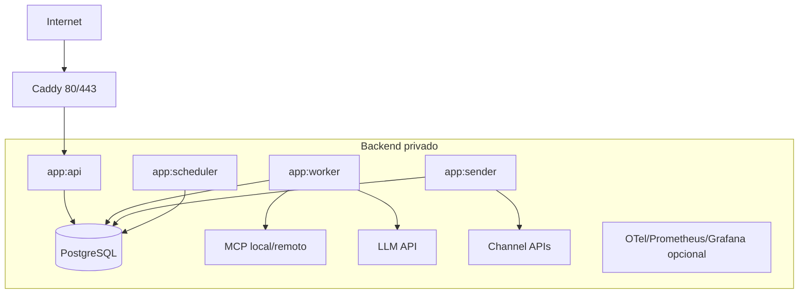

# Deploy de referência em VPS

## Objetivo

Executar sem serviços cloud gerenciados, usando containers e APIs externas apenas para canais, LLMs e integrações autorizadas.

## Topologia MVP

Todos os papéis `app:*` usam a mesma imagem fixada por digest/SHA.

## Serviços do Compose

- `caddy`: TLS e limites de entrada;
- `api`: webhooks e web API;
- `worker`: turns;
- `sender`: outbox;
- `scheduler`: watchdog/nudges/manutenção;
- `postgres`: fonte operacional;
- `migrate`: job explícito;
- MCPs locais opcionais;
- stack de observabilidade em profile separado.

## Rede

- somente Caddy publica portas públicas;
- admin/metrics em loopback, VPN ou rede privada;
- PostgreSQL e MCP local sem host port público;
- egress restrito quando possível;
- firewall permite apenas SSH controlado e 80/443.

## Secrets

- arquivos montados/Docker secrets, nunca no Compose versionado;
- startup falha quando secret obrigatório está ausente;
- rotação possui runbook e overlap quando necessário;
- tokens distintos por ambiente e integração.

## Recursos

Definir `mem_limit`, CPU e healthcheck por serviço. Reservar memória para SO e page cache. Worker de mídia recebe limite próprio; observabilidade não pode esgotar aplicação.

## Persistência e backup

- volume PostgreSQL dedicado;
- backup lógico/physical conforme RPO;
- cópia externa à VPS;
- criptografia e retenção;
- restore periódico em ambiente vazio;
- mídia/objetos com política própria.

## Deploy

1. CI constrói imagem imutável;
2. verificar digest, migrations e compatibilidade;
3. backup/restore point quando necessário;
4. rodar migration explícita;
5. atualizar papéis gradualmente;
6. smoke test live/ready e fluxo sintético;
7. observar janela definida;
8. rollback para digest anterior se critérios falharem.

## Readiness

- API ready quando consegue persistir entrada;
- worker ready quando banco/checkpointer/config estão utilizáveis;
- sender ready quando banco e adapter estão configurados;
- MCP ready quando protocolo, cache e dependências críticas estão válidos;
- LLM/canal podem aparecer degradados sem necessariamente derrubar API de entrada.

## Limite

Uma VPS não é HA. Quando SLO exigir tolerância à perda da máquina, evoluir para segunda instância, banco replicado/gerenciado ou outro desenho por ADR e testes.
