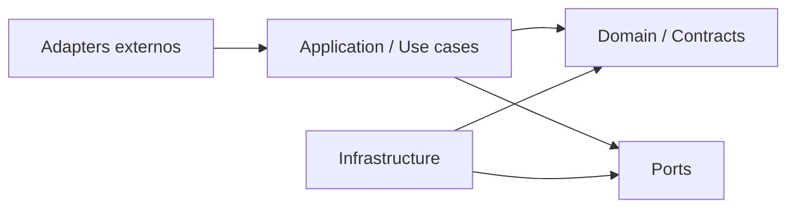

# Catálogo de módulos

## Direção geral



O domínio não conhece adapters. Use cases dependem de portas abstratas. Bootstrap conecta implementações.

## Módulos

| Módulo | Responsabilidade | API pública | Não deve fazer |
|---|---|---|---|
| `channels` | validar/normalizar entrada e renderizar saída por canal | `ChannelAdapter`, capability profile | executar agente ou regra de negócio |
| `identity` | ator, conta, tenant, credenciais e confiança | `IdentityResolver`, `AuthorizationPolicy` | inferir identidade só pelo telefone |
| `conversations` | sessões, mensagens, turns, foco e ordenação | `ConversationService`, repos | chamar provider diretamente |
| `orchestration` | supervisor, roteamento, state machines e políticas | `TurnOrchestrator` | importar framework concreto |
| `agent_runtime` | executar grafo/crew/agente via adapter | `AgentRuntime` | persistir fila operacional |
| `tools` | catálogo, escopo, autorização, MCP e resultados | `ToolGateway`, `ToolPolicy` | expor toda integração ao modelo |
| `memory` | contexto de sessão e memória durável curada | `MemoryStore`, `MemoryPolicy` | promover resumo operacional como fato global |
| `knowledge` | retrieval, citações, freshness e evidência | `KnowledgeRetriever` | decidir mutação externa |
| `jobs` | inbox, leases, retries, heartbeat, DLQ e watchdog | `JobQueue`, `LeaseManager` | conhecer prompts/agentes |
| `delivery` | outbox, sender, status e renderização final | `Outbox`, `DeliveryService` | criar conteúdo de negócio |
| `handoff` | revisão, aprovação, claim e retomada | `ReviewService`, `ApprovalPolicy` | enviar fora da outbox |
| `observability` | logs, métricas, traces, evals e correlação | instrumentation ports | ser fonte do estado operacional |
| `operations` | health, admin, backup, retention e rollout | endpoints/runbooks | acessar detalhes internos sem APIs |
| `governance` | versões, feature flags e políticas | `ReleaseContext`, registries | decidir silenciosamente risco residual |

## Shared kernel permitido

Somente tipos estáveis e pequenos:

- IDs tipados;
- `ChannelEnvelope`;
- `CorrelationContext`;
- erros e status canônicos;
- relógio e tipos de tempo;
- paginação e versionamento.

Não colocar regras de negócio, repos genéricos ou utilitários sem owner no shared kernel.

## Dependências permitidas

- `channels` → core contracts e ports de entrada;
- `orchestration` → conversations, identity, memory, knowledge, tools e agent runtime ports;
- `agent_runtime.adapters.*` → frameworks concretos;
- `tools.adapters.mcp` → SDK MCP;
- `delivery.adapters.*` → SDKs dos providers;
- `infrastructure.persistence` → SQLAlchemy/PostgreSQL;
- `bootstrap` → todos os adapters necessários.

## Dependências proibidas

- domain/application → FastAPI ou SQLAlchemy;
- orchestration → LangChain/CrewAI diretamente;
- tools → SDK de canal;
- channels → banco ou LLM;
- worker → cliente WhatsApp/Teams para mensagens de negócio;
- qualquer módulo → tabela privada de outro módulo sem porta/repositório explícito;
- observability → controle de fluxo obrigatório.

## Estrutura Python-alvo

```text
src/chat_app/
├── core/
│   ├── contracts.py
│   ├── ids.py
│   └── errors.py
├── modules/
│   ├── channels/
│   ├── identity/
│   ├── conversations/
│   ├── orchestration/
│   ├── agent_runtime/
│   ├── tools/
│   ├── memory/
│   ├── knowledge/
│   ├── jobs/
│   ├── delivery/
│   ├── handoff/
│   ├── observability/
│   └── operations/
├── adapters/
│   ├── http/
│   ├── persistence/
│   ├── channels/
│   ├── agents/
│   ├── mcp/
│   └── llm/
└── bootstrap.py
```

Projetos pequenos podem agrupar arquivos, mas não apagar as responsabilidades.
