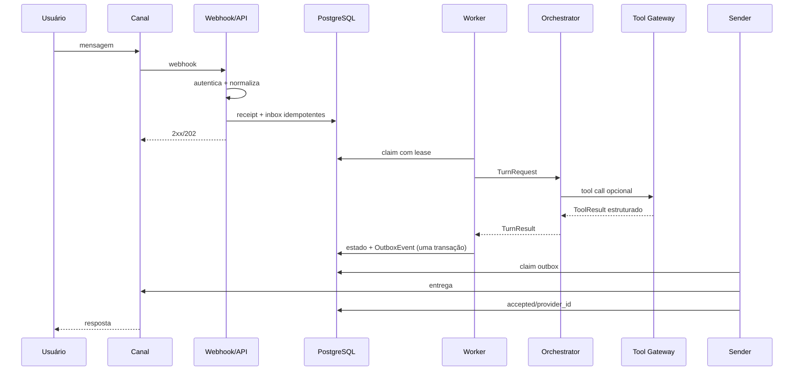
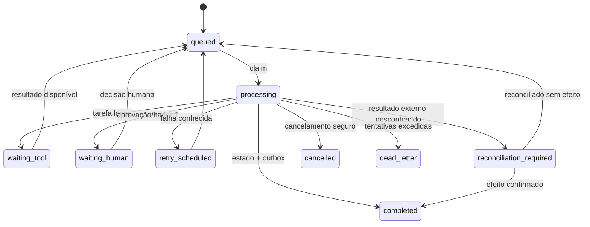

# Runtime, filas e experiência temporal

## Fluxo de entrada e resposta

## Estados do job

## Claim, lease e ordenação

- `FOR UPDATE SKIP LOCKED` permite múltiplos workers;
- somente um turn por `(tenant_id, conversation_id)` fica em processamento;
- claim define `locked_by` e `lease_until`;
- job longo renova lease em intervalo menor que metade do lease;
- atualização exige ownership do worker;
- lease expirado é avaliado pelo watchdog;
- job com possível efeito externo não é simplesmente reenfileirado.

## Heartbeat

Cada papel grava:

- service/role;
- instance ID único;
- started/last_seen;
- build SHA;
- current job opcional;
- readiness resumida.

Containers possuem healthcheck, mas heartbeat permite detectar processo vivo e loop travado.

## Watchdog

Procura:

- heartbeat vencido;
- lease expirado;
- backlog/idade da fila;
- outbox antiga;
- nudge pendente;
- handoff sem claim;
- cache/knowledge stale;
- DLQ e reconciliação abertas;
- jobs excedendo deadline.

Ações são idempotentes e auditadas.

## Nudge

Nudge é um job associado ao turn:

1. agendado ao iniciar processamento;
2. cancelado quando resposta fica durável;
3. enviado no máximo uma vez por estágio;
4. adaptado ao canal;
5. nunca afirma sucesso transacional;
6. pode dizer “consultando dados” ou “demorando mais que o normal”.

## Timeout e cancelamento

- deadline global do turn;
- timeout por LLM/tool/mídia/provider;
- `cancel_requested_at` consultado entre etapas;
- chamada cancelável recebe cancel token;
- mutação já iniciada pode exigir reconciliação, não cancelamento fictício;
- resposta final distingue cancelado, não iniciado e resultado desconhecido.

## Long-running tasks

Processamento longo sai do worker principal:

- cria `background_task` durável;
- tool adapter inicia operação;
- scheduler/worker especializado acompanha progresso;
- progresso gera eventos/nudges;
- conclusão reenfileira o turn ou cria outbox;
- polling usa backoff e deadline;
- callback/webhook é deduplicado.

## Debounce e agrupamento

Mensagens textuais consecutivas podem ser agrupadas por janela curta. Mídia ou comando de cancelamento força flush. O receipt original é preservado para auditoria.
