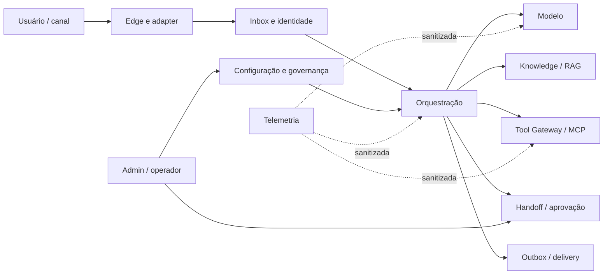

# Fundamentos e princípios de design

## Abstração do sistema

Para esta referência, um chat/assistente é um sistema que:

1. recebe uma interação por um canal não confiável;
2. autentica, normaliza, deduplica e persiste;
3. cria um turn durável e resolve identidade/tenant;
4. constrói contexto permitido de conversa, memória e knowledge;
5. escolhe um fluxo determinístico ou agentic;
6. invoca modelos e tools sob budgets e policies;
7. valida o resultado e qualquer pós-condição;
8. grava estado e resposta na outbox;
9. entrega, acompanha status e reconcilia;
10. produz telemetria e evidência para avaliação e auditoria.

O modelo é apenas um componente desse percurso.

## Princípios do AWS Lens adaptados

### 1. Projetar autonomia controlada

A agência cresce somente quando a complexidade da tarefa exige. Use fluxo determinístico para autorização, transação, roteamento crítico, confirmação e pós-condição. Agentes recebem catálogo de tools filtrado, budgets, stop conditions, timeout, cancelamento e handoff.

**Pergunta de revisão:** o que o modelo pode propor, o que o código decide e quem pode interromper?

### 2. Implementar observabilidade abrangente

Observar experiência do usuário, estado operacional, comportamento do modelo, retrieval, tools, entrega, segurança, custo e impacto. Correlacionar tudo sem transportar PII ou secrets. Telemetria explica a execução; o banco operacional decide o que aconteceu.

**Pergunta de revisão:** um operador consegue reconstruir um turn sem acessar conteúdo sensível desnecessário?

### 3. Otimizar eficiência de recursos

Selecionar modelo, contexto, embedding, compute e capacidade com dados. Roteamento por tarefa, limites de contexto, processamento incremental, autoscaling e retenção reduzem custo e impacto sem esconder falhas.

**Pergunta de revisão:** qual evidência demonstra que cada recurso é necessário ao resultado?

### 4. Estabelecer resiliência distribuída

Falhas de canal, modelo, tool, banco, rede, AZ ou região são esperadas. Persistência, idempotência, leases, outbox, checkpoints, circuit breakers, bulkheads, fallback aprovado e reconciliação preservam a verdade do sistema.

**Pergunta de revisão:** como o sistema distingue falha conhecida de resultado externo desconhecido?

### 5. Padronizar gestão de recursos

Prompts, modelos, tools, schemas, knowledge, guardrails, datasets e deployment devem ter catálogo, owner, versão, compatibilidade, lifecycle e rollback. Mudanças fora do pipeline são detectadas.

**Pergunta de revisão:** qual conjunto exato de artefatos produziu esta resposta?

### 6. Proteger fronteiras de interação

Edge, identidade, tenant, modelo, dados, tool, operador e telemetria são fronteiras distintas. Cada uma exige autenticação, autorização, validação, limites, auditoria e comportamento de falha. Conteúdo externo é dado, não instrução confiável.

**Pergunta de revisão:** qual é a menor informação e permissão necessária em cada salto?

## Princípios adicionais desta referência

### Durabilidade antes de inteligência

Mensagem aceita deve sobreviver a crash e indisponibilidade do LLM. O webhook não executa IA. O turn é processado at-least-once e todo efeito é idempotente ou reconciliável.

### Verdade transacional antes de fluência

Uma resposta eloquente não pode afirmar que uma ação ocorreu sem pós-condição persistida. `outcome_unknown` é um estado de primeira classe e bloqueia replay cego.

### Contexto é uma concessão, não um depósito

Cada chamada recebe somente mensagens, memória, documentos e ferramentas necessários. Contexto tem finalidade, tenant, classificação, freshness e retenção.

### Feedback não é automaticamente fato

Feedback, memória e conteúdo recuperado podem estar errados ou ser adversariais. Promoção para memória durável ou knowledge requer provenance e política de curadoria.

### Portabilidade por portas

AWS, outro provedor ou self-hosting implementam `AgentRuntime`, `KnowledgeRetriever`, `ToolGateway`, `ChannelAdapter` e infraestrutura. O domínio não importa SDK de nuvem.

## Fronteiras de confiança

Cada seta possui contrato, identidade, classificação de dados, timeout, erro canônico e owner.

## Decisão de agência

| Nível | Padrão | Uso típico | Controles mínimos |
|---|---|---|---|
| 0 | resposta determinística | FAQ fixa, status, comandos | autenticação, schema, outbox |
| 1 | LLM em etapa isolada | classificação, extração, reformulação | schema, eval, fallback |
| 2 | workflow com LLM e tools predefinidas | atendimento, consulta e atualização guiada | state machine, tool policy, idempotência |
| 3 | agente com loop limitado | investigação, pesquisa e plano | max steps, budgets, trace, stop reason |
| 4 | híbrido plan-and-solve | tarefas complexas e assíncronas | fila de tarefas, checkpoints, aprovação, reconciliação |
| 5 | alta autonomia | raramente justificável | análise de risco específica, sandbox, kill switch e supervisão contínua |

A escolha default é o menor nível que satisfaz o objetivo e os SLOs.

## Definition of Well-Architected para um turn

Um turn é considerado bem arquitetado quando:

- a entrada é autêntica, deduplicada e durável;
- identidade, tenant e contexto estão autorizados;
- modelo, prompt, parâmetros, tools e knowledge são versionados;
- a trajetória respeita budgets, timeouts e stop conditions;
- saída e efeitos passam por validação determinística;
- estado e outbox são gravados atomicamente;
- entrega e efeitos são idempotentes ou reconciliados;
- feedback, métricas, logs, traces e audit events permitem avaliação;
- dados sensíveis seguem finalidade e retenção aprovadas;
- existe caminho de cancelamento, handoff e rollback.
