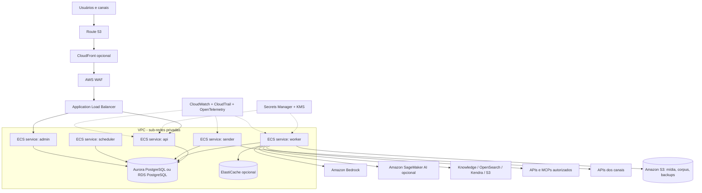
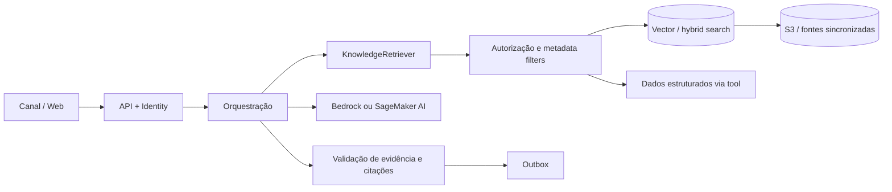
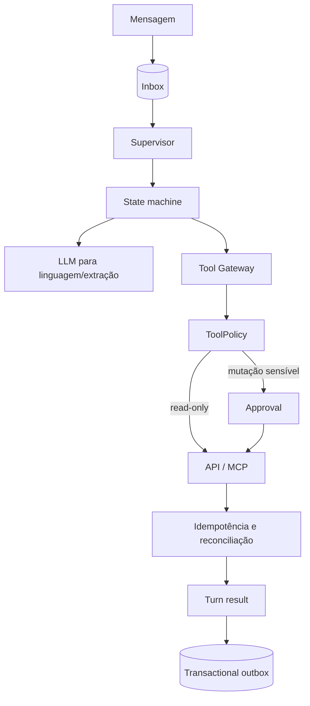
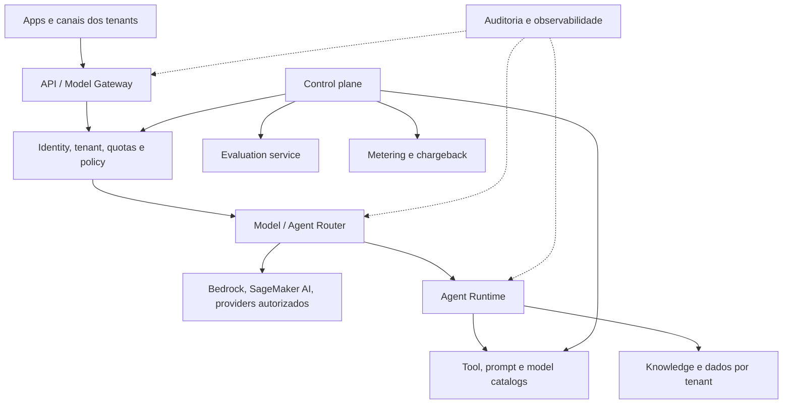
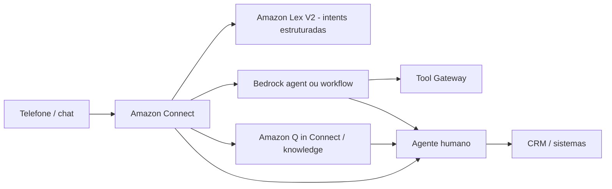
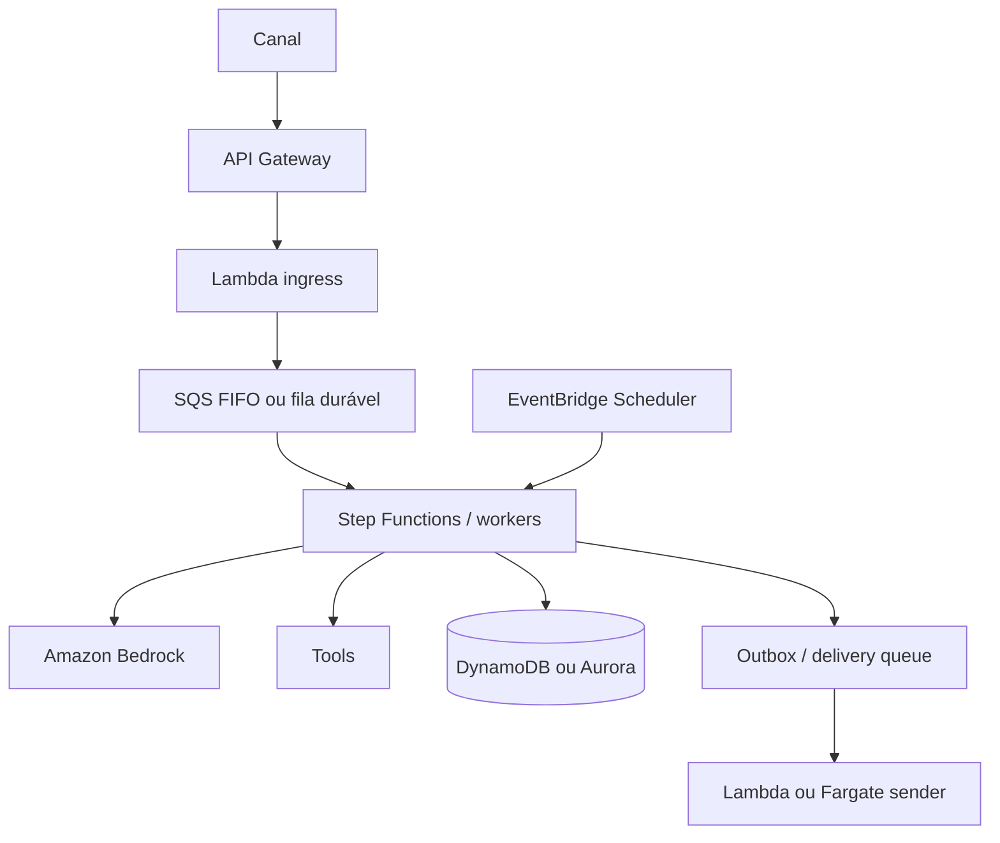
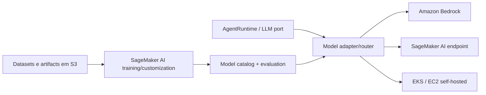

# Arquiteturas-base de chats e assistentes na AWS

## Princípio de seleção

As arquiteturas abaixo são perfis de implantação. Todas preservam os contratos do monólito modular e as portas de canal, modelo, knowledge, tools e persistência. Escolha a menor topologia que atenda risco, SLO, capacidade e equipe; introduza serviços adicionais somente com evidência e ADR quando a estrutura mudar.

## Arquitetura A: monólito modular gerenciado em ECS/Fargate

É o perfil AWS mais próximo da referência em VPS.

**Quando usar:** MVP e produção com equipe pequena/média, preferência por containers, PostgreSQL como estado operacional e necessidade de escalar papéis separadamente.

**Invariantes:** mesma imagem por digest para os papéis; webhook não chama LLM; PostgreSQL mantém inbox/lease/outbox; sender é o único dono da entrega; admin é privado; observabilidade é best effort.

**Trade-offs:** mais simples que microsserviços, mas ainda exige operação de banco, containers, rede, migrations e capacity planning. Multi-AZ reduz falhas de infraestrutura, não elimina bugs ou falhas regionais.

## Arquitetura B: assistente RAG corporativo

**Opções AWS:** Amazon Bedrock Knowledge Bases, Amazon OpenSearch Service, Amazon Kendra, Amazon S3, AWS Glue Data Catalog, Amazon Redshift e adapters SQL. Amazon Q Business ou Amazon Q in QuickSight podem ser produtos gerenciados quando o caso se encaixa.

**Controles essenciais:** ACL atual por documento/linha, tenant em toda consulta, provenance, freshness, proteção contra indirect prompt injection, dataset de retrieval, reconstrução de índice e resposta sem RAG apenas quando policy permitir.

## Arquitetura C: assistente transacional com tools e aprovação

**Quando usar:** agendamento, suporte com atualização, tickets, pedidos, operações internas e qualquer fluxo que produz efeito externo.

**Controles essenciais:** tools não são chamadas diretamente pelo modelo; scopes e credenciais são resolvidos fora do prompt; mutações possuem idempotency key; outcome unknown bloqueia replay; confirmação e aprovação são persistentes; resposta só afirma sucesso após pós-condição.

## Arquitetura D: plataforma multi-tenant de GenAI/chat

**Quando usar:** várias unidades de negócio, produtos ou tenants compartilham acesso governado a modelos, RAG, agents e ferramentas.

**Separação recomendada:**

- **control plane:** onboarding, modelos, prompts, policies, quotas, budgets, evals e releases;
- **data plane:** inferência e execução de turns;
- **tenant plane:** identidade, dados, tools, limites, chaves e custo;
- **operations plane:** auditoria, incidentes, DLQ, reconciliação e capacity.

**Controles essenciais:** isolamento em chaves e policies, quota por tenant, metering, data residency, catálogo aprovado, guardrails consistentes, model gateway sem acesso irrestrito e testes cross-tenant.

## Arquitetura E: contact center omnichannel

**Estratégia de adoção:** começar por fluxos frequentes e simples; escalar para RAG e ações complexas; sempre preservar contexto no handoff. Voz, gravações e transcrições têm classificação e retenção próprias.

## Arquitetura F: event-driven/serverless

**Quando usar:** carga muito variável, tarefas naturalmente event-driven e equipe preparada para limites de execução, duplicidade e observabilidade distribuída.

**Importante:** este perfil altera a decisão de PostgreSQL como fila operacional e a topologia de processos. Exige ADR, preservação de ordering/idempotência/outbox/reconciliação e testes equivalentes. Step Functions não elimina a necessidade de estado de negócio e audit events.

## Arquitetura G: modelo customizado ou self-hosted

**Quando usar:** requisito de modelo próprio, modalidade, performance, isolamento ou economics que managed inference não atende.

**Controles essenciais:** model card, dataset/data card, lineage, artifact integrity, endpoint autoscaling, patching, vulnerability scan, capacity, drift, rollback, licença e plano de depreciação. O adapter mantém o núcleo independente.

## Mapeamento de módulos para serviços AWS

| Módulo da referência | Baseline AWS | Alternativas/observações |
|---|---|---|
| edge e channels | Route 53, CloudFront, WAF, ALB/API Gateway | adapter continua validando assinatura do provider |
| identity | IAM Identity Center, Cognito ou IdP externo | identidade de usuário não é a role de workload |
| jobs/inbox/outbox | Aurora/RDS PostgreSQL | SQS/Step Functions somente por ADR e contratos equivalentes |
| compute | ECS/Fargate com a mesma imagem por papel | EKS, Lambda ou EC2 conforme perfil |
| model access | Amazon Bedrock | SageMaker AI ou provider externo por adapter |
| agent runtime | runtime próprio em worker; Bedrock Agents opcional | framework permanece atrás de `AgentRuntime` |
| tools | Tool Gateway próprio; APIs privadas; MCP | Bedrock Agent action groups são adapter, não bypass de policy |
| knowledge | Bedrock Knowledge Bases, OpenSearch, Kendra, S3 | Redshift/Glue/SQL para dados estruturados |
| memory | PostgreSQL e stores governados | ElastiCache somente para cache, não verdade operacional |
| media/corpus | S3 com KMS e lifecycle | malware scan, metadata, retenção e URL curta |
| secrets | Secrets Manager/Parameter Store + KMS | nunca em imagem, prompt ou log |
| observability | CloudWatch, CloudTrail, ADOT/X-Ray | OpenTelemetry como contrato neutro |
| delivery | ECS/Lambda sender para APIs dos canais | status do provider volta como evento deduplicado |
| CI/CD | GitHub Actions ou AWS CodePipeline/CodeBuild | imagens no ECR por digest, IaC e gates |

## Matriz de escolha

| Necessidade dominante | Arquitetura inicial | Evolução provável |
|---|---|---|
| chat profissional em produção | A | B ou C conforme knowledge/tools |
| consulta corporativa com fontes | A + B | D quando várias unidades compartilham plataforma |
| ações transacionais | A + C | approvals avançados e multi-Region quando SLO exigir |
| contact center | E | C para ações e B para knowledge |
| muitos produtos/tenants | D | células por região/tenant e control plane separado |
| carga altamente variável | F | Fargate para tarefas longas e Aurora para transações |
| modelo próprio | A + G | EKS/EC2 apenas com capacidade operacional comprovada |

## Critérios antes de escolher um serviço

- contrato e portabilidade necessária;
- regiões, residência e classificação de dados;
- modelo de responsabilidade e acesso;
- quota, throughput, latência e falhas;
- custo total e compromisso;
- observabilidade e auditabilidade;
- backup, restore, versionamento e depreciação;
- compatibilidade com idempotência, outbox e reconciliação;
- competência da equipe e runbook.
