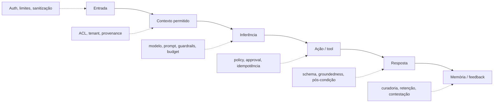
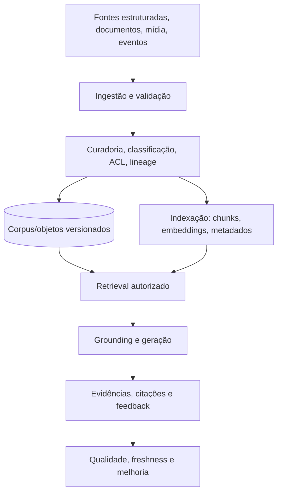
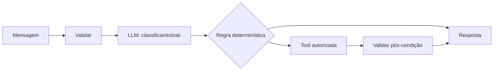
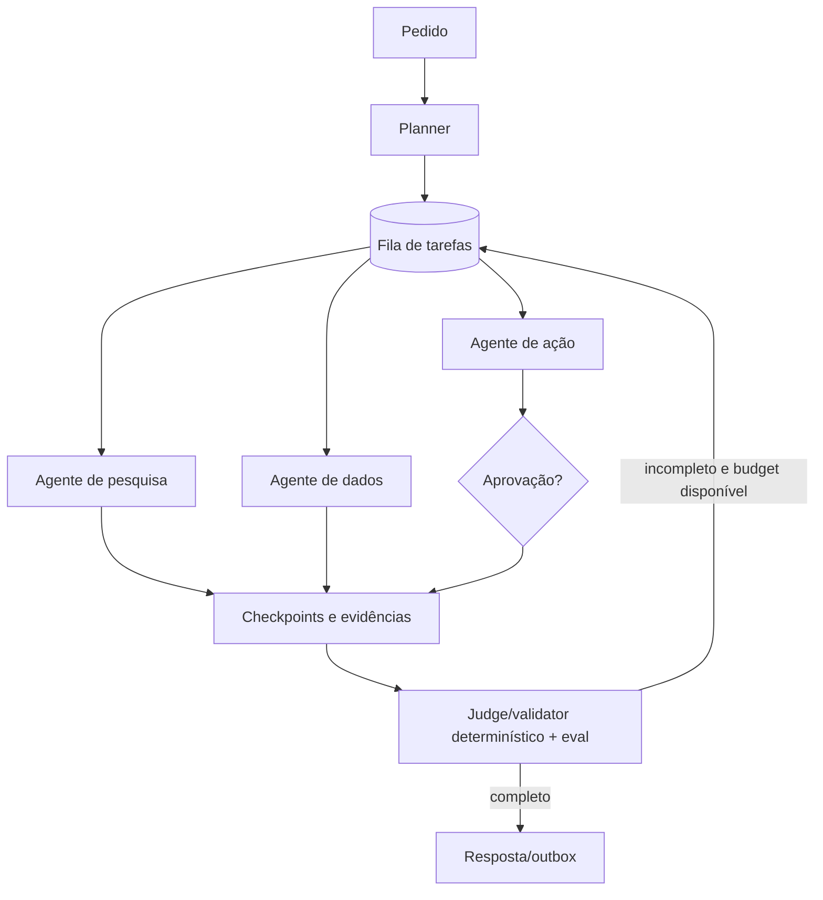

# Responsible AI, lifecycle, dados e Agentic AI

## Responsible AI para chats e assistentes

Responsible AI deve ser convertido em controles, testes, owners e caminhos de contestação. As oito dimensões do AWS Lens são aplicadas assim:

| Dimensão | Risco em chats/assistentes | Controles e evidências |
|---|---|---|
| Fairness | qualidade, recusa ou encaminhamento desigual entre grupos, idiomas ou canais | avaliação segmentada e legalmente apropriada, análise de disparate, datasets representativos, revisão humana e correção documentada |
| Explainability | usuário ou operador não entende fonte, decisão ou limite | citar fontes quando aplicável, separar fato de inferência, reason codes para policies, trajetória de tools auditável e explicação proporcional ao risco |
| Privacy and security | exposição de conversa, memória, documentos, secrets ou dados de outro tenant | minimização, classificação, criptografia, ACLs em retrieval, menor privilégio, redaction, retenção e testes cross-tenant |
| Safety | conteúdo nocivo, instrução perigosa ou automação de dano | guardrails em camadas, domínio permitido, validação de output, aprovação, bloqueio e handoff |
| Controllability | agente entra em loop, ignora limite ou age além do esperado | max steps, budgets, timeout, cancelamento, kill switch, feature flags, approvals e rollback |
| Veracity and robustness | alucinação, fonte stale, prompt injection ou resultado frágil | RAG com provenance, evals adversariais, schemas, pós-condições, confidence policy, recusa e `outcome_unknown` |
| Governance | artefatos e decisões sem owner, versão ou auditoria | catálogo de modelos/prompts/tools, RACI, change control, audit events, segregação de funções e revisão periódica |
| Transparency | usuário não sabe que fala com IA, como dados são usados ou quais limites existem | disclosure de IA, capability/limitation notice, consentimento quando aplicável, política de dados, indicação de handoff e canal de recurso |

### Controles ao longo do turn

### Gate de alto risco

Casos envolvendo saúde, finanças, emprego, crédito, identidade, acesso, pagamento, exclusão, publicação, segurança física ou direitos devem documentar:

- finalidade e população afetada;
- base legal e classificação de dados;
- decisão automatizada versus recomendação;
- revisão humana competente e SLA;
- explicação e contestação;
- métricas segmentadas e red team;
- limites de responsabilidade e fallback;
- owner executivo, técnico, segurança e jurídico/compliance.

## Lifecycle adaptado

O documento oficial organiza o trabalho em seis fases nomeadas. Esta referência transforma cada fase em entregáveis e gates.

### 1. Scoping

**Perguntas:** o problema precisa de GenAI? Qual valor, risco, custo e alternativa determinística? Que nível de agência é necessário?

**Entregáveis:** visão, personas, intents, non-goals, métricas de sucesso, SLOs, risk profile, Responsible AI assessment, data map, threat model inicial, orçamento e decisão POC/MVP/Profissional.

**Gate:** caso de uso viável, owner definido, risco aceitável e hipótese mensurável.

### 2. Model selection

**Perguntas:** qual modalidade, contexto, qualidade, latência, região, data policy, custo e disponibilidade são necessários? Um único modelo basta?

**Entregáveis:** scorecard de modelos, benchmark em dataset representativo, model catalog, routing/fallback policy e restrições de dados.

**Gate:** modelo e fallback atendem thresholds de qualidade, segurança, latência e custo.

### 3. Model customization

**Escada recomendada:** parâmetros e prompt -> RAG -> tools/workflow -> fine-tuning -> continuous pre-training. Cada passo exige evidência de que o anterior não basta.

**Entregáveis:** prompt catalog, knowledge design, datasets/data cards, experimentos, evals, Responsible AI recheck e ADR quando houver fine-tuning/custom model.

**Gate:** ganho reproduzível supera custo, risco e manutenção; rollback e versão existem.

### 4. Development and integration

**Perguntas:** como o modelo entra no fluxo, acessa dados, chama tools, persiste estado, entrega resposta e falha com segurança?

**Entregáveis:** contratos, state machines, adapters, ToolPolicy, guardrails, RAG, handoff, testes de contrato/concorrência/falha, tracing e UI/canal.

**Gate:** fatia vertical durável; mutações idempotentes; sem acesso direto de framework/provider no core.

### 5. Deployment

**Perguntas:** como reproduzir, promover, observar, escalar, proteger, fazer backup, restaurar e reverter?

**Entregáveis:** IaC, CI/CD, image digest, migrations, secrets, readiness, alarms, dashboards, runbooks, backup/restore, load test e rollout gradual.

**Gate:** smoke e fluxo sintético passam; rollback e restore foram exercitados; capacidade é conhecida.

### 6. Continuous improvement

**Perguntas:** o produto continua correto, seguro, útil e economicamente viável sob dados e comportamento reais?

**Entregáveis:** feedback loop, eval periódico, release comparison, drift/freshness, incident review, cost review, security review, revisão do Lens e depreciação de artefatos.

**Gate:** melhoria tem baseline, evidência, owner e critério de reversão.

## Arquitetura de dados

### Três usos de dados

1. **Pre-training:** fora do caminho padrão deste template. Exige programa de dados e compute próprio; deve ser tratado como workload separado.
2. **Customização:** datasets menores e curados para fine-tuning, alignment ou avaliação. Exige provenance, qualidade, licença, privacidade, bias testing e lineage.
3. **RAG e acesso a dados em tempo de execução:** caminho mais comum. Requer baixa latência, ACL atual, freshness, evidência e proteção contra indirect prompt injection.

Chats também usam dados estruturados por tools/SQL. Não transforme toda fonte estruturada em texto quando regras, autorização e consistência exigem consulta determinística.

### Camadas recomendadas

### Imperativos estratégicos

- **Qualidade como fundação:** validação, reconciliação de fontes, freshness, completeness e owner.
- **Arquitetura unificada sem apagar fronteiras:** catálogo e APIs comuns, mas autorização continua na fonte e no tenant.
- **Privacy-first:** minimização, finalidade, retenção, criptografia, localização e exclusão desde o design.
- **Dados estruturados e não estruturados:** preservar semântica, schema, metadados e relações.
- **Multimodal:** tratar texto, áudio, imagem e vídeo com pipelines, riscos e retenções próprios.
- **Tempo real quando necessário:** streaming somente quando o valor e o SLO justificarem a complexidade.

### Framework de implementação

- catálogo e descoberta de fontes;
- contratos de ingestão e data quality;
- pipelines incrementais e idempotentes;
- chunking por tipo de conteúdo;
- avaliação de embeddings e retrieval;
- ACL/metadata filtering e revalidação de permissão;
- manifestos de índice, versão e rebuild;
- observabilidade de dados e lineage;
- lifecycle, retenção, legal hold e delete;
- métricas de valor: tempo para responder, qualidade, adoção e risco evitado.

### Fatores de sucesso e modelo operacional

- **Infraestrutura escalável:** storage, compute e pipelines crescem por demanda e são testados com volumes representativos.
- **Data observability:** qualidade, freshness, lineage, falhas de ingestão, ACL e comportamento do retrieval têm métricas e owners.
- **Colaboração cross-functional:** produto, dados, engenharia, segurança, operações, jurídico/compliance e especialistas de domínio compartilham vocabulário, gates e RACI.
- **Democratização governada:** self-service usa catálogo, APIs e templates, sem bypass de autorização ou classificação.
- **Medição de sucesso:** acompanhar data quality, tempo para disponibilizar uma fonte, retrieval quality, adoção, incidentes, custo e valor de negócio.
- **Centro de excelência proporcional:** padrões reutilizáveis, golden paths e revisão de exceções, evitando um time central virar gargalo.

### Memória versus knowledge

| Estado | Finalidade | Escrita | Confiança | Retenção |
|---|---|---|---|---|
| histórico de sessão | continuidade imediata | automática | conteúdo do usuário, não fato verificado | curta/configurável |
| resumo de conversa | compressão de contexto | automática com versão | derivado, pode conter erro | curta e revisável |
| memória de usuário | preferência ou fato persistente | policy/consentimento | precisa de provenance e revogação | explícita |
| memória organizacional | aprendizado coletivo | curadoria/aprovação | alto risco de poisoning | governada |
| knowledge base | fonte recuperável | pipeline de dados | depende de fonte, ACL e freshness | conforme fonte |
| estado operacional | execução e pós-condição | transacional | fonte de verdade do sistema | conforme operação/auditoria |

## Agentic AI

### Padrão A: workflow aumentado por LLM

Código controla o caminho e o LLM classifica, extrai, resume ou formula. É o default para fluxos transacionais e de atendimento previsível.

### Padrão B: agente autônomo limitado

Um loop reason-and-act seleciona tools, mas opera com allowlist, budgets e stop conditions. Use em pesquisa ou diagnóstico onde o caminho não pode ser enumerado antecipadamente.

### Padrão C: híbrido plan-and-solve

Um planejador cria tarefas; uma fila durável executa subagentes especializados; um agregador verifica completude. Cada tarefa é idempotente, possui deadline e pode exigir aprovação.

### Regras invariantes para agents

- agency proporcional à tarefa;
- tools filtradas por identidade, tenant, estado e risco;
- instruções de tool e schemas versionados;
- credenciais nunca entram no contexto do modelo;
- mutação exige idempotency key e pós-condição;
- loops têm max steps, tokens, tempo e custo;
- tarefas longas saem do worker do turn;
- falha de observabilidade não muda o estado;
- resultado desconhecido exige reconciliação;
- handoff e kill switch são caminhos normais, não exceções.
