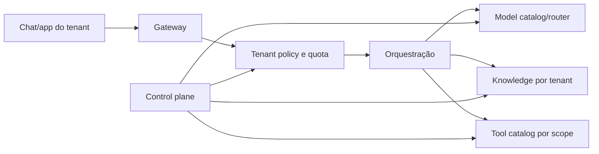
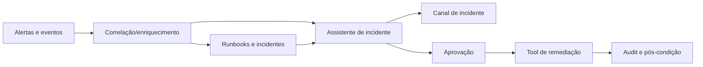

# Cenários do AWS Lens adaptados para chats e assistentes

## Como ler

Cada cenário oficial foi reinterpretado como uma composição dos módulos desta referência. A lista de serviços é indicativa; o núcleo continua cloud-neutral. Para todos os cenários valem autenticação, tenant, persistência antes de processar, policies, outbox, handoff, observabilidade sanitizada e avaliação contínua.

## 1. Plataforma multi-tenant de GenAI

### Objetivo

Oferecer a várias unidades de negócio um ponto governado para criar e operar chats, copilots e agents, com catálogo de modelos, prompts, tools, knowledge, evals, quotas e chargeback.

### Fluxo adaptado

### Controles

- control plane e data plane separados;
- rate limit, budget, metering e logs por tenant;
- chaves, modelos, índices, prompts e tools isolados;
- modelos e integrações entram por processo de onboarding;
- eval framework e golden datasets reutilizáveis;
- guardrails mínimos centralizados, com políticas adicionais do produto;
- federação permitida sem retirar governança central.

### Fatia MVP

Um tenant interno, dois modelos aprovados, um RAG, um tool read-only, quota, metering, audit e onboarding documentado. Só depois habilitar self-service e múltiplos tenants.

### Métricas

Tempo de onboarding, adoção, custo/tenant, taxa de policy denial, cross-tenant test pass, qualidade por aplicação, quota saturation e incidentes compartilhados.

## 2. Contact center autônomo com handoff

### Objetivo

Atender voz e chat com automação gradual, preservando contexto e escalando para humano quando intenção, confiança, risco ou preferência exigirem.

### Fluxo adaptado

- Amazon Connect recebe contato e executa contact flow;
- Amazon Lex V2 trata intents estruturadas;
- Amazon Q in Connect ou RAG fornece conhecimento;
- Bedrock/AgentRuntime atende linguagem e casos ambíguos;
- Tool Gateway executa consulta ou ação autorizada;
- handoff entrega transcript sanitizado, resumo, identidade, evidências e ações já tentadas ao atendente.

### Controles

Disclosure de IA, gravação/consentimento, retenção por mídia, DTMF/PCI redaction quando aplicável, confidence threshold, confirmação de ação, prevenção a prompt injection por voz/documento, nudge e rota de emergência.

### Adoção em fases

1. FAQ, horário, localização e status read-only;
2. RAG, contexto multi-turn e agent assist;
3. ações controladas e follow-up tasks;
4. otimização de routing, qualidade e automação com revisão humana.

### Métricas

Containment com qualidade, first contact resolution, tempo de handoff, repetição de informação, CSAT, falsa afirmação de sucesso, taxa de transferência e cobertura de consentimento.

## 3. Business intelligence generativa

### Objetivo

Permitir perguntas em linguagem natural sobre dados estruturados e não estruturados sem romper row/column/document security.

### Dois perfis

- **gerenciado:** Amazon Q Business para documentos e Amazon Q in QuickSight para dados analíticos;
- **customizado:** chat próprio com Bedrock, Knowledge Bases, Redshift/Glue/SQL tools e visualizações.

### Controles

- identidade federada e autorização revalidada na fonte;
- queries SQL geradas passam por parser, allowlist, limites e role read-only;
- metadata filters e ACLs por documento;
- fonte, período, query e transformação visíveis ao usuário;
- valores agregados e inferências distinguidos;
- execução cara ou exportação exige limite/aprovação.

### Fatia MVP

Um domínio de negócio, um conjunto de dashboards/tabelas curadas, glossário semântico, queries read-only, um corpus documental, 30-50 perguntas douradas e revisão por analistas.

### Métricas

Precisão de query, execução segura, groundedness, cobertura de fontes, tempo até insight, consultas bloqueadas, custo e diferença contra resposta do analista.

## 4. Transformação de código com GenAI

### Objetivo

Modernizar código em etapas auditáveis sem permitir que o agente faça merge ou deploy irreversível sem gates humanos e automáticos.

### Pipeline adaptado

1. ingestão do repositório e inventário de dependências;
2. análise e plano de transformação;
3. alteração em sandbox/branch isolada;
4. build, testes, SAST, licenças e validação funcional;
5. PR com resumo, riscos, evidências e rollback;
6. revisão humana e rollout controlado.

AWS Transform é uma opção gerenciada para domínios suportados; um agente próprio deve usar credenciais mínimas e ambiente efêmero.

### Controles

Repository allowlist, branch protection, nenhum secret no contexto, sandbox sem produção, limite de arquivos/tempo/custo, provenance das mudanças, testes antes/depois, human approval e rollback.

### Fatia MVP

Dois ou três projetos representativos, alta cobertura de testes, mudança aditiva e sem dados de produção. Medir taxa de build, defeitos, review time e esforço humano.

## 5. Copiloto de knowledge worker para SMB/DB

### Objetivo

Unificar pesquisa factual, análise aprofundada e exploração iterativa em documentos, e-mail, CRM, finanças e sistemas operacionais, com modos explícitos de velocidade/profundidade/custo.

### Padrões de interação

- **quick:** lookup factual, resposta curta e fonte;
- **balanced:** síntese multi-source com retrieval e poucas tools;
- **deep research:** plano assíncrono, múltiplas fontes, checkpoints e relatório;
- **iterative:** memória de sessão e refinamento sem promover fatos automaticamente.

### Controles críticos

Permissão em tempo real, proteção contra inferential disclosure, metadata/provenance, freshness, memória curada, cost mode visível, citações, contestação e revalidação de ACL.

### Estratégia de dados

- documentos: chunking e embeddings por tipo;
- estruturados: SQL/tool com schema e role controlados;
- híbrido: narrativas somente quando não sacrificam consistência e autorização;
- memória: sessão, usuário e organização com policies separadas.

### Fatia MVP

Duas fontes, um grupo de usuários, read-only, quick/balanced, sem memória organizacional. Avaliar perguntas reais, ACL e qualidade antes de deep research.

## 6. Resposta a incidentes assistida por GenAI

### Objetivo

Reduzir MTTR por correlação de alertas, busca de runbooks/incidentes anteriores, hipótese guiada e recomendações, sem permitir remediação autônoma insegura.

### Camadas

### Controles

Separar dados de clientes/tenants, sanitizar logs, limitar comandos, usar runbooks versionados, exigir aprovação para mudança, capturar evidências, marcar hipóteses, nunca ocultar incerteza, e preservar operação manual quando o assistente falhar.

### Fatia MVP

Somente read-only: resumir incidente, recuperar runbook, encontrar similares e montar timeline. Remediação entra depois de simulações, game days e approvals.

### Métricas

MTTA/MTTR, precisão de runbook, hipóteses aceitas, comandos bloqueados, regressões, tempo de handoff e incidentes onde IA atrasou a resposta.

## 7. Code review automatizado

### Objetivo

Revisar PRs com padrões gerais e específicos do time, priorizando findings acionáveis e mantendo o humano como aprovador final.

### Fluxo

Webhook do repositório -> validação/dedupe -> job assíncrono -> diff e contexto mínimo -> análise estática + LLM -> policy/grounding em guias -> comentário ou review draft -> feedback humano.

### Controles

Token read-only quando possível, limites de diff/arquivo, nenhuma execução de código não confiável fora de sandbox, proteção de IP/secrets, source citations para regras, supressão versionada, false-positive feedback e sem auto-merge.

### Fatia MVP

Uma linguagem, um repositório, classes de finding limitadas, comentários em draft e comparação com reviewers. Fine-tuning só após prompt/RAG não atenderem.

### Métricas

Precisão/recall de findings, false positives, tempo de review, findings aceitos, vulnerabilidades escapadas, custo por PR e taxa de bypass.

## 8. Workflow Kanban automatizado

### Objetivo

Avaliar qualidade de tickets e sugerir decomposição em subtarefas, mantendo product owner e equipe no controle.

### Fluxo

Evento do Jira/board -> fila/event bus -> workflow durável -> análise de completude -> solicitação de dados ou proposta de subtarefas -> aprovação -> criação idempotente -> audit/feedback.

Na AWS, SNS/EventBridge, Lambda, Step Functions e Bedrock são uma composição possível; o mesmo comportamento pode ser implementado pelos jobs do monólito.

### Controles

Webhook autenticado, idempotency key por ticket/versão, prompt catalog, limites de quantidade, não atribuir pessoas ou estimativas sensíveis sem policy, aprovação antes de mutar o board e reconciliação de chamadas com resultado desconhecido.

### Fatia MVP

Somente sugestões em comentário para um projeto. Depois habilitar criação de subtarefa com aprovação explícita e rollback.

### Métricas

Aceitação das sugestões, edição posterior, tempo de refinamento, duplicidade, tickets bloqueados por falta de informação, custo e satisfação da equipe.

## Padrões recorrentes nos oito cenários

- começar com escopo simples e read-only;
- integrar humano antes de aumentar autonomia;
- preservar permissionamento das fontes;
- usar event-driven e jobs duráveis para tarefas longas;
- tratar prompts, modelos e knowledge como artefatos versionados;
- medir qualidade de negócio, não apenas latência ou tokens;
- construir auditabilidade e rollback desde o início;
- escolher customização somente com evidência;
- projetar custo e capacidade por tenant/fluxo;
- manter canal e UI desacoplados da orquestração.
